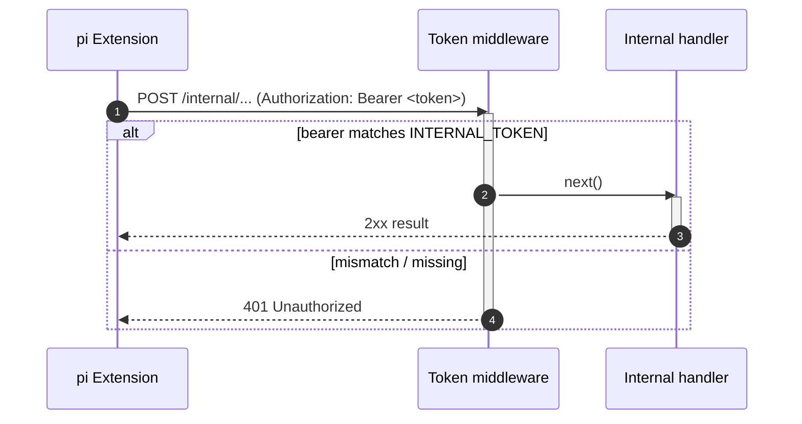
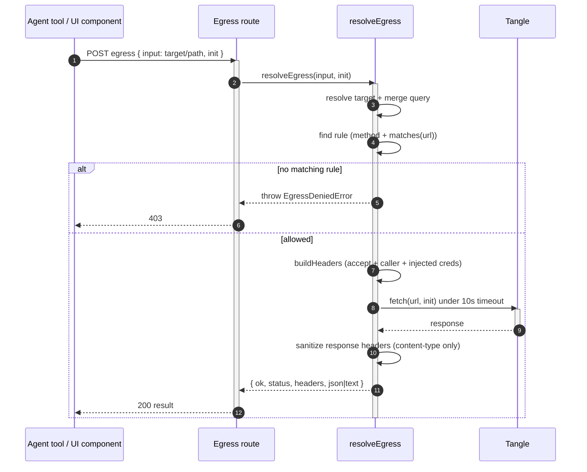

# Egress and Security

[< Back to index](./index.md)

This document covers the server's trust boundaries: the internal-token model
that guards agent-driven APIs, the egress allowlist proxy that lets agents and
sandboxed UI components reach a small set of external endpoints without holding
credentials, the various path-traversal guards, and the trigger-handler worker
isolation. It ends with security findings.

---

## The internal-token trust model

Each `pi` child is spawned with `TANGENT_INTERNAL_URL` and
`TANGENT_INTERNAL_TOKEN` in its environment
([piAgentManager.ts](../../server/src/pi/piAgentManager.ts)). The five always-on
extensions present that token as `Authorization: Bearer <token>` on every call
to the server's internal API.

`INTERNAL_TOKEN` ([config.ts](../../server/src/config.ts)) is a per-start
`randomUUID()` unless pinned via env. Every internal router installs
`requireInternalToken` — `requireCredential(piCredential)`
([requireInternalToken.ts](../../server/src/middleware/requireInternalToken.ts)) —
which rejects any request the Pi connector's credential does not verify. The byte
comparison lives in the credential facet, not the route:

- `/internal/agents` ([internalAgents.ts](../../server/src/routes/internalAgents.ts))
- `/internal/memory` ([internalMemory.ts](../../server/src/routes/internalMemory.ts))
- `/internal/triggers` ([internalTriggers.ts](../../server/src/routes/internalTriggers.ts))
- `/internal/session` ([internalSession.ts](../../server/src/routes/internalSession.ts))
- `/internal/egress` ([internalEgress.ts](../../server/src/routes/internalEgress.ts))

This keeps arbitrary local processes from driving a session's agents, mutating
memory or triggers, renaming sessions, or making egress calls. The token never
leaves the host (the URL defaults to loopback on `PORT`).

The shared token says a caller is _some_ Pi child; it cannot say which. Each
spawn therefore also mints a per-process `TANGENT_AGENT_TOKEN`
([`AgentTokenCredential`](../../server/src/connectors/credentials.ts)), held
only by that process and the agent manager. An extension presents it as
`x-tangent-agent-token`, and [`agentCaller.ts`](../../server/src/auth/agentCaller.ts)
resolves it (constant-time, live agents only) to the `(sessionId, agentId)` it
was minted for. A respawn mints a new token; a kill forgets the old one. Where
an internal route takes a `sessionId` or a caller-naming `agentId` in its body
or query, a request whose token resolves to a different agent is refused with
`403 { code: "agent_mismatch" }`; one whose token no live agent holds is
refused with `401 { code: "agent_unknown" }` and logged. A request without the
header is handled as before, so older extensions keep working while the header
rolls out.

---

## Who a request is from

[`resolveIdentity`](../../server/src/auth/identity.ts) reads the caller of an
HTTP request or Socket.IO handshake from the first configured source that
carries a token, in trust order:

1. `TRUSTED_IDENTITY_HEADER` — a participant identity assertion stamped by a
   trusting front proxy. It outranks everything because the proxy that sets it
   also strips any copy a client sent; without such a proxy leave it empty.
2. `Authorization: Bearer` (or the handshake `auth.token`) — honoured only when
   `EMBED_ALLOWED_ORIGINS` is non-empty, the one deployment where a cross-origin
   host has to carry its own token.
3. `AUTH_JWT_TOKEN_HEADER_NAME`, then `AUTH_JWT_TOKEN_COOKIE_NAME`.

No source is signature-checked here; the claims (`email` or `sub`, names) are
read as presented, and the backend is the only verifier. When a token has no
`email` claim the server uses `sub` as the participant id, so an identity
assertion issuer must put the participant's email in `sub`: an opaque subject
would be shown and compared as if it were an email. Tokens from the first
two sources are also kept, per participant, in the in-memory
[identity assertion cache](../../server/src/auth/identityAssertions.ts) along
with their `exp`, fed by every `/api` request and socket handshake and dropped
once expired. The web client refreshes it by calling `GET /api/me` before a chat
message when its last request is more than 30 minutes old.

A Run carries an identity set: the ordered list of humans who wrote into the
turn ([`RunRegistry`](../../server/src/runs/runRegistry.ts)). A human message
that opens a Run sets it to `[author]`; one that steers or follows up a Run in
flight appends the author (or moves them to the end); an agent or automation
wake inherits the participant's last set; a sub-agent inherits its spawner's.
The most recent member is the acting default — the person remote tools route
to.

---

## The egress allowlist proxy

Agents and sandboxed bundle-UI components must never hold outbound credentials
and must not reach arbitrary hosts. Both go through
[`resolveEgress`](../../server/src/bundleUi/egressAllowlist.ts), which resolves
logical targets from server configuration, validates the resulting URL against a
fixed allowlist, performs the real `fetch` server-side (injecting credentials),
and returns a JSON-safe response with only allowlisted headers.

Two routes wrap the same resolver:

- `POST /internal/egress` — the **agent-side** proxy (token-guarded), used by
  bundle tool extensions running inside `pi` (e.g. a Tangle API tool).
- `POST /api/agent-bundles/ui-egress` — the **bundle-UI** `host.fetch` proxy used
  by sandboxed UI components.

Allowlist properties:

- Bundle UI callers should use logical target input such as
  `{ target: "tangle", path: "/api/executions/<id>/state" }`; trusted internal
  tools may still pass absolute `http(s)` URLs for compatibility.
- Rules cover the configured Tangle API origin (`TANGLE_API_URL`) for specific
  `pipeline_runs` / `executions` / `artifacts` paths, project reads and
  create/update operations, and workspace reads. Saved-pipeline rules allow
  `GET /api/users/me`, `GET` / `PUT /api/users/me/pipelines`, and `GET` / `PUT`
  on `/api/pipelines/<UUID>`. These identity and saved-pipeline rules are
  restricted to the token-guarded internal agent route. The public bundle-UI
  proxy cannot select that capability through its request body. Other
  user-pipeline routes remain denied.
- Caller headers are limited to `accept` and `content-type`. Credentials are
  injected by the rule's `headers()`, so a caller cannot replace the backend
  identity and bundle UI code never sees the credential. This is not a boundary
  against agents: Pi children inherit the server environment (including
  `TANGLE_TOKEN` when set) and `TANGENT_INTERNAL_TOKEN`, so an agent with `bash`
  can call this route, or the backend, directly.
- Responses surface only `content-type`; a 10s `AbortController` timeout bounds
  both fetching and consuming the response body. Transport failures map to a
  502 with safe configuration or timeout diagnostics. Raw transport errors can
  contain credentials and are not returned to callers. Backend HTTP statuses
  and response bodies are preserved in the egress response envelope.

### Saved pipeline authoring

Bundle tools can submit a complete definition through the internal egress route
without a connected browser editor. The backend remains responsible for pipeline
validation, ownership checks, persistence, and versioning. Creation uses
`PUT /api/users/me/pipelines?file_path=...`; subsequent reads can use the same
path, and reads or updates can use the saved pipeline UUID. Opening a saved
pipeline in the UI is an optional step after confirmed persistence.

Configure `TANGLE_API_URL` and the established trusted authentication in the
deployment wrapper (`TANGLE_TOKEN` for cookie-based deployments, or the
deployment's authenticated network path). `GET /api/users/me` identifies the
backend caller. The proxy does not impersonate session participants, so every
agent write runs as that one identity: anyone who can message an agent in a
session can have it create or overwrite pipelines that identity may write,
including pipelines other owners have shared with it for editing.

A failed or timed-out response does not prove that a write was rolled back.
Read the original `file_path` and compare the persisted definition before
retrying an uncertain save. The proxy does not retry writes automatically.
Closing the last browser socket detaches presence without cancelling the
server-side agent. This does not make an agent task durable across a server
restart.

---

## Other guards

- **ZIP path traversal** — both the bundle installer (`isSafeEntryPath` in
  [bundleLoader.ts](../../server/src/pi/config/bundleLoader.ts)) and the manifest
  validator (`isSafeRelativePath` in
  [manifest.ts](../../server/src/pi/config/manifest.ts)) reject entries with
  `..`, absolute paths, or drive prefixes, so a malicious archive can't write
  outside the session root.
- **File serving** — the artifact/upload handler validates the session id and
  confines resolved paths to the `artifacts/`/`uploads/` subtrees (see
  [sessions-and-storage.md](./sessions-and-storage.md)).
- **Bundle ids as directory names** — `isUnsafeId` guards both the marketplace
  store and the upload destination.
- **Trigger handler isolation** — compiled trigger handlers run in a worker
  thread with an empty env, a 64 MB heap ceiling, and a 5s wall-clock timeout
  (see [triggers.md](./triggers.md)). This is fault isolation + a hard timeout,
  **not** a sandbox against deliberately malicious code; handlers are trusted
  bundle-author code (same trust model as Pi tool extensions).
- **CORS** — Socket.IO is configured with `cors: { origin: true }` to ease local
  dev where the UI is proxied by Vite (same-origin in practice).

---

## Security notes

### Note 1: egress credentials are deployment secrets

`TANGLE_TOKEN` is read from the process environment and injected as a cookie
header only inside the server-side egress proxy. Do not commit this value, bake it
into Docker images, or expose it to bundle UI workers.

### Note 2: default-open internal token in misconfigured deploys

`INTERNAL_TOKEN` is a per-start random UUID, which is sound. But because
`INTERNAL_URL` defaults to loopback and the token guards real capabilities,
deployments must ensure the internal routers are not exposed beyond loopback and
that `TANGENT_INTERNAL_TOKEN`, if pinned via env, is treated as a secret.

### Note 3: durability of session state

Session metadata, the agent roster, participants, memberships, runs, and the
resource catalog are persisted in the SQLite `tangent.db`; chat transcripts are
append-only JSONL under each session's `.tangent/chats/`
([sessions-and-storage.md](./sessions-and-storage.md)). Both survive a restart —
so a deployment must treat the database file and the session root as the durable
state to back up and protect, not as scratch space.
