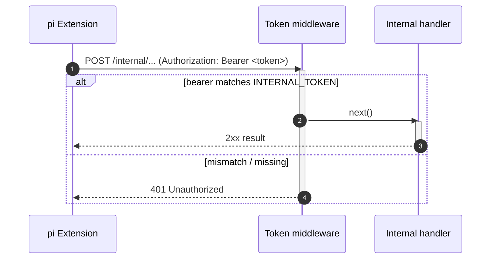
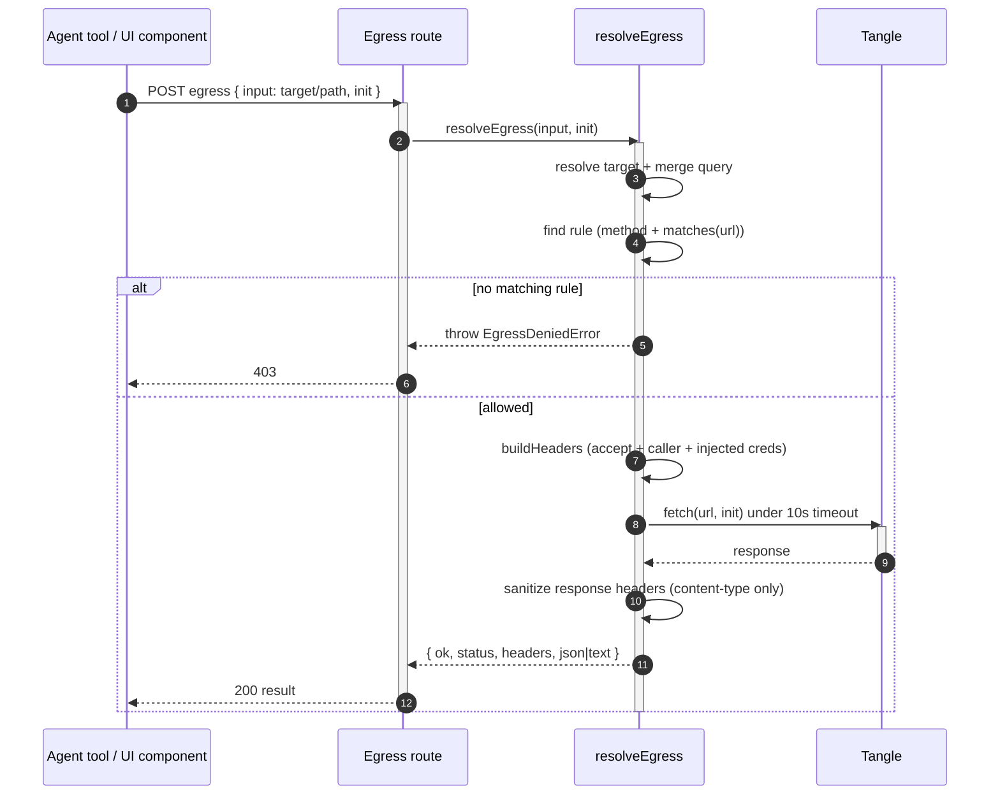

# Egress and Security

[< Back to index](./index.md)

This document covers the server's trust boundaries: the internal-token model
that guards agent-driven APIs, the egress allowlist proxy that lets agents and
sandboxed UI components reach a small set of external endpoints without holding
credentials, the various path-traversal guards, and the trigger-handler worker
isolation. It ends with security findings.

---

## The internal-token trust model

Each `pi` child is spawned with `TANGENT_INTERNAL_URL` and
`TANGENT_INTERNAL_TOKEN` in its environment
([piAgentManager.ts](../../server/src/pi/piAgentManager.ts)). The five always-on
extensions present that token as `Authorization: Bearer <token>` on every call
to the server's internal API.

`INTERNAL_TOKEN` ([config.ts](../../server/src/config.ts)) is a per-start
`randomUUID()` unless pinned via env. Every internal router installs
`requireInternalToken` — `requireCredential(piCredential)`
([requireInternalToken.ts](../../server/src/middleware/requireInternalToken.ts)) —
which rejects any request the Pi connector's credential does not verify. The byte
comparison lives in the credential facet, not the route:

- `/internal/agents` ([internalAgents.ts](../../server/src/routes/internalAgents.ts))
- `/internal/memory` ([internalMemory.ts](../../server/src/routes/internalMemory.ts))
- `/internal/triggers` ([internalTriggers.ts](../../server/src/routes/internalTriggers.ts))
- `/internal/session` ([internalSession.ts](../../server/src/routes/internalSession.ts))
- `/internal/egress` ([internalEgress.ts](../../server/src/routes/internalEgress.ts))

This keeps arbitrary local processes from driving a session's agents, mutating
memory or triggers, renaming sessions, or making egress calls. The token never
leaves the host (the URL defaults to loopback on `PORT`).

---

## The egress allowlist proxy

Agents and sandboxed bundle-UI components must never hold outbound credentials
and must not reach arbitrary hosts. Both go through
[`resolveEgress`](../../server/src/bundleUi/egressAllowlist.ts), which resolves
logical targets from server configuration, validates the resulting URL against a
fixed allowlist, performs the real `fetch` server-side (injecting credentials),
and returns a JSON-safe response with only allowlisted headers.

Two routes wrap the same resolver:

- `POST /internal/egress` — the **agent-side** proxy (token-guarded), used by
  bundle tool extensions running inside `pi` (e.g. a Tangle API tool).
- `POST /api/agent-bundles/ui-egress` — the **bundle-UI** `host.fetch` proxy used
  by sandboxed UI components.

Allowlist properties:

- Bundle UI callers should use logical target input such as
  `{ target: "tangle", path: "/api/executions/<id>/state" }`; trusted internal
  tools may still pass absolute `http(s)` URLs for compatibility.
- Rules cover the configured Tangle API origin (`TANGLE_API_URL`) for specific
  `pipeline_runs` / `executions` / `artifacts` paths, project reads and
  create/update operations, and workspace reads. Saved-pipeline rules allow
  `GET /api/users/me`, `GET` / `PUT /api/users/me/pipelines`, and `GET` / `PUT`
  on `/api/pipelines/<UUID>`. These identity and saved-pipeline rules are
  restricted to the token-guarded internal agent route. The public bundle-UI
  proxy cannot select that capability through its request body. Other
  user-pipeline routes remain denied.
- Caller headers are limited to `accept` and `content-type`. Credentials are
  injected by the rule's `headers()`, so a caller cannot replace the backend
  identity and bundle UI code never sees the credential. This is not a boundary
  against agents: Pi children are not given `TANGLE_TOKEN`, but they do get
  `TANGENT_INTERNAL_TOKEN` and run as the server's OS user, so an agent with
  `bash` can call this route directly (see
  [Note 1](#note-1-egress-credentials-are-deployment-secrets)).
- Responses surface only `content-type`; a 10s `AbortController` timeout bounds
  both fetching and consuming the response body. Transport failures map to a
  502 with safe configuration or timeout diagnostics. Raw transport errors can
  contain credentials and are not returned to callers. Backend HTTP statuses
  and response bodies are preserved in the egress response envelope.

### Agent proxy errors

`POST /internal/egress` answers its own failures with a non-200 status and a
body of `{ error, code }`. `error` is for people and may change; `code` is
stable:

| Status | `code`                 | Meaning                                                               |
| ------ | ---------------------- | --------------------------------------------------------------------- |
| 403    | `egress_denied`        | The destination or method isn't allowlisted. Nothing was sent.        |
| 403    | `team_not_granted`     | The call set `actAsTeam` without a grant. Nothing was sent.           |
| 502    | `upstream_timeout`     | Tangle didn't answer within 10s. A write may still have persisted.    |
| 502    | `upstream_unreachable` | The request to Tangle failed in transport, e.g. a refused connection. |
| 502    | `egress_failed`        | Any other failure.                                                    |

Tangle's own answers, refusals included, come back as a 200 whose envelope
carries Tangle's `status` and body, so no `code` describes them. Request
validation (400) and the internal token check (401) keep their own bodies.

### Saved pipeline authoring

Bundle tools can submit a complete definition through the internal egress route
without a connected browser editor. The backend remains responsible for pipeline
validation, ownership checks, persistence, and versioning. Creation uses
`PUT /api/users/me/pipelines?file_path=...`; subsequent reads can use the same
path, and reads or updates can use the saved pipeline UUID. Opening a saved
pipeline in the UI is an optional step after confirmed persistence.

Configure `TANGLE_API_URL` and the established trusted authentication in the
deployment wrapper (`TANGLE_TOKEN` for cookie-based deployments, or the
deployment's authenticated network path). `GET /api/users/me` identifies the
backend caller. The proxy does not impersonate session participants, and the
saved-pipeline rules never act as a team (see [Acting team](#acting-team)), so
every saved-pipeline write runs as that one identity: anyone who can message an
agent in a session can have it create or overwrite pipelines that identity may
write, including pipelines other owners have shared with it for editing.

A failed or timed-out response does not prove that a write was rolled back.
Read the original `file_path` and compare the persisted definition before
retrying an uncertain save. The proxy does not retry writes automatically.
Closing the last browser socket detaches presence without cancelling the
server-side agent. This does not make an agent task durable across a server
restart.

---

## Acting team

Team-scoped Tangle calls (submitting or cancelling a run, editing run
annotations, listing secrets) can act as a team by carrying the team
impersonation header (`TANGLE_TEAM_HEADER`, default
`x-tangle-impersonate-team-id`). Whether a call may is the server's decision;
whether it does is the caller's:

- **Grant.** The team comes from the **Run** the calling agent is in, never from
  the caller. Any copy of the header a caller sends is stripped on every egress
  route.
- **Opt in.** A call acts as the granted team only when its
  `POST /internal/egress` body sets `actAsTeam: true`. Without it the call goes
  as the server's own Tangle identity, even on a granted turn. Opting in without
  a grant is a 403 with `code: "team_not_granted"` (see
  [Agent proxy errors](#agent-proxy-errors)), not a silent fallback. The flag
  has no effect on rules that are not team-scoped.

Tangle resolves a run's secrets against the run's creator. A run submitted as
the team can use only the team's secrets, and one submitted without it only the
server identity's own, so a tool keeps the secrets it lists and the identity it
submits with the same.

A Run gets a grant only along the causal chain from a human message:

- The host sends `actingTeamId` on a chat message (`getActingTeam` on
  `TangentProvider`). It applies to that message only and is not persisted.
- The Runs that message opens are granted that team. A Prime directive or a
  sub-agent report carries the authoring Run's grant, and so does an agent's
  finished turn when it is relayed to Prime.
- Triggers, reactor wakes, system messages and remote or A2A agents carry none.
  A Run never inherits a grant from an earlier one.
- A message queued onto a busy agent: a follow-up (a new turn) switches the Run
  to its own grant, and a steer (which changes the running turn) keeps the grant
  only if it matches, otherwise it drops it.

The caller is identified by `TANGENT_AGENT_TOKEN`, a per-process secret minted at
spawn and presented as `x-tangent-agent-token`. It is not the ids in the request
body. `GET /internal/egress/granted-team` returns `{ grantedTeam }`, the team the
caller's turn may act as, or `null`.

Every resolved `POST /internal/egress` response carries `appliedTeam`: the team
that request went upstream as, taken from the same decision that set the header,
including when Tangle then refuses it. It is `null` when no team was applied,
whether for lack of a grant or because the call didn't opt in, so it never means
"unknown". The bundle-UI `host.fetch` response has no `appliedTeam`, since that
route never acts as a team.

---

## Other guards

- **ZIP path traversal** — both the bundle installer (`isSafeEntryPath` in
  [bundleLoader.ts](../../server/src/pi/config/bundleLoader.ts)) and the manifest
  validator (`isSafeRelativePath` in
  [manifest.ts](../../server/src/pi/config/manifest.ts)) reject entries with
  `..`, absolute paths, or drive prefixes, so a malicious archive can't write
  outside the session root.
- **File serving** — the artifact/upload handler validates the session id and
  confines resolved paths to the `artifacts/`/`uploads/` subtrees (see
  [sessions-and-storage.md](./sessions-and-storage.md)).
- **Bundle ids as directory names** — `isUnsafeId` guards both the marketplace
  store and the upload destination.
- **Trigger handler isolation** — compiled trigger handlers run in a worker
  thread with an empty env, a 64 MB heap ceiling, and a 5s wall-clock timeout
  (see [triggers.md](./triggers.md)). This is fault isolation + a hard timeout,
  **not** a sandbox against deliberately malicious code; handlers are trusted
  bundle-author code (same trust model as Pi tool extensions).
- **CORS** — Socket.IO is configured with `cors: { origin: true }` to ease local
  dev where the UI is proxied by Vite (same-origin in practice).

---

## Security notes

### Note 1: egress credentials are deployment secrets

`TANGLE_TOKEN` is read from the process environment and injected as a cookie
header only inside the server-side egress proxy. It is removed from the `pi`
child environment, so agents are not handed a way around the proxy. Do not commit
this value, bake it into Docker images, or expose it to bundle UI workers.

Tangle authorizes against this token's identity, not the human's: a granted
team names which team a call may act as, but cannot grant more than the token
holds. The team is a claim from the host, trusted like the bearer token. Agent
tokens stop one agent from posing as another through the API. Neither they nor
removing `TANGLE_TOKEN` are a hard boundary while agents run as the same OS user
as the server, since that user can read other processes' environments.

### Note 2: default-open internal token in misconfigured deploys

`INTERNAL_TOKEN` is a per-start random UUID, which is sound. But because
`INTERNAL_URL` defaults to loopback and the token guards real capabilities,
deployments must ensure the internal routers are not exposed beyond loopback and
that `TANGENT_INTERNAL_TOKEN`, if pinned via env, is treated as a secret.

### Note 3: durability of session state

Session metadata, the agent roster, participants, memberships, runs, and the
resource catalog are persisted in the SQLite `tangent.db`; chat transcripts are
append-only JSONL under each session's `.tangent/chats/`
([sessions-and-storage.md](./sessions-and-storage.md)). Both survive a restart —
so a deployment must treat the database file and the session root as the durable
state to back up and protect, not as scratch space.
