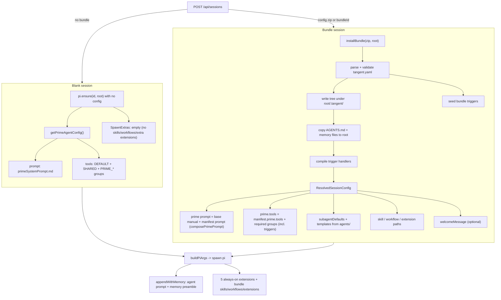
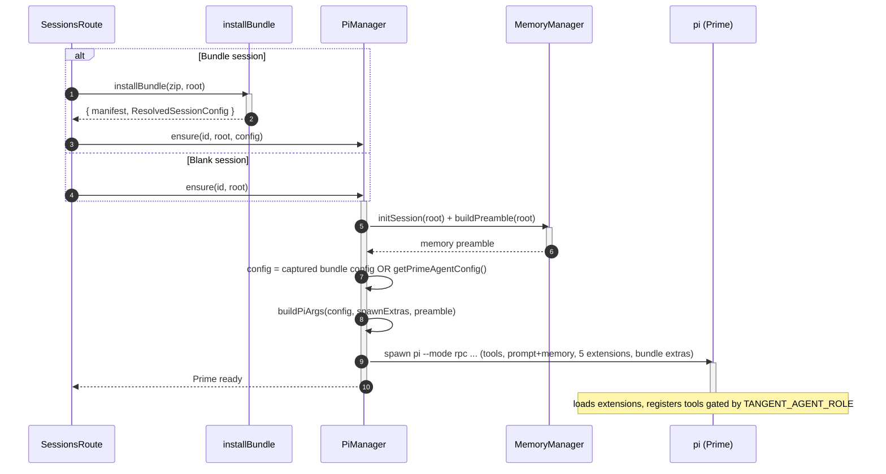

# Extensions and Prompts: Blank vs Bundle Sessions

[< Back to index](./index.md)

Every `pi` process in a session is spawned from an `AgentConfig` (tool allowlist

- appended system prompt) plus a set of `SpawnExtras` (skills, workflows, extra
  extensions). How that config is produced differs between a **blank session**
  (created without a bundle) and a **bundle session** (created from a Configuration
  Bundle). This document explains both paths, the five always-on extensions, the
  per-role tool gating, and the prompt resolution precedence.

The relevant code: [agentConfig.ts](../../server/src/pi/agentConfig.ts),
[piAgentManager.ts](../../server/src/pi/piAgentManager.ts) (`buildPiArgs`,
`spawnExtras`, `appendWithMemory`),
[config/bundleLoader.ts](../../server/src/pi/config/bundleLoader.ts), and
[utils.ts](../../server/src/pi/utils.ts) (the extension paths).

---

## The seven always-on extensions

Regardless of how a session is created, `buildPiArgs` adds these seven
`--extension` paths to every agent (Prime and sub-agents). They are authored
against Pi's extension runtime (`@ts-nocheck`, never imported by the server) and
are thin clients over the server's `/internal/*` API:

| Extension      | File                                                                           | Tools registered                                                                                         | Role gating           |
| -------------- | ------------------------------------------------------------------------------ | -------------------------------------------------------------------------------------------------------- | --------------------- |
| Orchestrator   | [extensions/orchestrator.ts](../../server/src/pi/extensions/orchestrator.ts)   | `read_room`; `message_prime`; `spawn_subagent` / `message_subagent` / `kill_subagent` / `list_subagents` | all; sub-agent; Prime |
| Proxy provider | [extensions/proxyProvider.ts](../../server/src/pi/extensions/proxyProvider.ts) | registers `anthropic`/`openai`/`google`/`groq`/`xai` providers against `PI_PROXY_URL`                    | n/a (no tools)        |
| Memory         | [extensions/memory.ts](../../server/src/pi/extensions/memory.ts)               | `read_memory`; `remember` / `suggest_memory`                                                             | all; Prime            |
| Resources      | [extensions/resources.ts](../../server/src/pi/extensions/resources.ts)         | `read_resources`                                                                                         | all                   |
| Triggers       | [extensions/triggers.ts](../../server/src/pi/extensions/triggers.ts)           | `create_trigger` / `list_triggers` / `enable_trigger` / `disable_trigger` / `delete_trigger`             | Prime only            |
| Session        | [extensions/session.ts](../../server/src/pi/extensions/session.ts)             | `pin_artifact`; `rename_session`                                                                         | all; Prime            |
| Remote tools   | [extensions/remoteTools.ts](../../server/src/pi/extensions/remoteTools.ts)     | `list_remote_tools` / `call_remote_tool` / `list_environments`                                           | all                   |

Each extension reads `TANGENT_AGENT_ROLE` and only registers the higher-privilege
tools when the role is `prime`. The proxy-provider extension exists because in a
container (`HOME=/tmp`) Pi has no auto-discovered provider config, so it would
otherwise fail to reach any model.

### Why extension tools must also be in `--tools`

Pi's `--tools` allowlist filters **extension and custom tools too**, not just
built-ins. So if `spawn_subagent` (registered by the orchestrator extension) is
not listed in Prime's allowlist, Pi strips it even though the extension
registered it. That is why `agentConfig.ts` defines tool-name groups that are
unioned into the allowlist:

- `DEFAULT_TOOLS` = `read, write, edit, bash, grep, find, ls`.
- `SHARED_AGENT_TOOLS` = `read_room, message_prime, pin_artifact,
list_remote_tools, call_remote_tool, list_environments` (granted to every
  agent, even though `message_prime` is only _registered_ for sub-agents and the
  remote-tools trio only functions when a host is connected — the allowlist must
  still permit them).
- `PRIME_ORCHESTRATION_TOOLS`, `PRIME_TRIGGER_TOOLS`, `PRIME_SESSION_TOOLS` —
  Prime-only tool names.
- **Recall tools are not static either.** `SESSION_RECALL_TOOLS`
  (`list_related_sessions`, `search_session_transcripts`,
  `read_session_transcript`) are granted at spawn only to Prime in a session with
  at least one selector tag. Only that spawn loads the extra
  [extensions/sessionRecall.ts](../../server/src/pi/extensions/sessionRecall.ts)
  extension, sets `TANGENT_SESSION_RECALL=1` (the extension registers nothing
  without it), and appends the "Related sessions" preamble. Everywhere else they are stripped from `--tools`, even when a bundle
  or spawn request lists them. They read `/internal/session/{related,search,transcript}`,
  which only reach sessions carrying every selector of the caller (and, when
  restricted, sharing its owner); anything else is refused with one fixed answer.
- **Memory tools are not static.** They are contributed at spawn by the session's
  resolved memory (see [memory.md](./memory.md)): `SimpleMdMemory` adds
  `read_memory` for every agent and `remember` / `suggest_memory` for Prime, and a
  session's `pi-memory` binding adds its own tools by role. The manager
  unions these into `--tools` from `memoryPlan.allowlistTools`, so the allowlist —
  not the extension registration — is the real role gate.

---

## Blank vs bundle: how the config is built

### Blank session path

When `POST /api/sessions` carries no bundle, the route calls
`pi.ensure(session.id, session.rootPath)` with **no** config
([routes/sessions.ts](../../server/src/routes/sessions.ts)). The manager spawns
Prime with `session.config?.prime ?? getPrimeAgentConfig()`. Since there's no
session config:

- **Prime prompt** = [primeSystemPrompt.md](../../server/src/pi/primeSystemPrompt.md) (the
  always-on Tangent Shell manual: operating rules, sub-agent orchestration,
  artifacts + `pin_artifact`, uploads, triggers, session naming, memory). Built
  via `composePrimePrompt()` with no bundle layer.
- **Prime tools** = `DEFAULT_TOOLS` + `SHARED_AGENT_TOOLS` +
  `PRIME_ORCHESTRATION_TOOLS` + `PRIME_TRIGGER_TOOLS` + `PRIME_SESSION_TOOLS`,
  plus the memory tools the resolved memory contributes at spawn.
- **SpawnExtras** = empty (`spawnExtras(undefined)` returns empty arrays), so no
  `--skill` / `--prompt-template` / extra `--extension` flags — except any
  `--extension` the resolved memory adds (e.g. a `pi-memory` binding).
- **Sub-agents** spawned later resolve against the **global** templates
  ([server/src/pi/agents/](../../server/src/pi/agents)) and the base
  [subagentSystemPrompt.md](../../server/src/pi/subagentSystemPrompt.md).

### Bundle session path

When the request carries a multipart `config` ZIP or a marketplace `bundleId`,
`createSessionFromBundle` calls `installBundle` and then
`pi.ensure(id, root, config)` with the resolved config. The
`ResolvedSessionConfig` ([agentConfig.ts](../../server/src/pi/agentConfig.ts))
drives every spawn:

- **Prime prompt** = the always-on `primeSystemPrompt.md` manual followed by the
  bundle's `prime.systemPrompt` file, composed by `composePrimePrompt(...)`. So
  every bundle Prime inherits the Shell operating manual and the bundle only adds
  task-specific instructions on top.
- **Prime tools** = `manifest.prime.tools` (or `DEFAULT_TOOLS`) unioned with
  `SHARED_AGENT_TOOLS` + the Prime-only groups, now including
  `PRIME_TRIGGER_TOOLS` (`resolvePrimeTools`), plus the memory tools contributed
  at spawn. So a bundle never needs to list
  orchestration/memory/trigger/session tools; they're always added (matching a
  blank session).
- **subagentDefaults** = `{ tools, appendSystemPrompt }` from the manifest's
  `subagents` block.
- **templates** = parsed from the installed `.tangent/agents/*.md`.
- **skillPaths / workflowPaths / extensionPaths** = absolute paths resolved
  against the installed tree, passed as repeated `--skill` (dir containing
  `SKILL.md`), `--prompt-template`, and extra `--extension` flags to **every**
  agent in the session.
- **welcomeMessage** (optional) = pre-seeded as Prime's first message so the
  agent "speaks first" (no LLM call) on join.

Additionally, the bundle's `AGENTS.md` (rules) and seed memory/context files are
copied to the workspace root so Pi auto-discovers them from `cwd`, and the
bundle's declared triggers are seeded into the session. See
[configuration-bundles.md](./configuration-bundles.md).

---

## Sequence: spawning Prime in each mode

---

## Sub-agent prompt + tool resolution precedence

When Prime spawns a sub-agent, `resolveSubagentConfig(request, { templates,
defaults })` resolves the effective config:

- **Tools** (`pickTools`): inline `request.tools` > template `tools` >
  session/bundle `defaults.tools` > `DEFAULT_TOOLS`. Then `SHARED_AGENT_TOOLS`
  are always merged in (deduped).
- **System prompt** (`pickPrompt`): the always-on base `subagentSystemPrompt.md`
  manual is always prepended by `composeSubagentPrompt(...)`; the specific layer on top
  is resolved by precedence inline `request.systemPrompt` > template
  `systemPrompt` > `defaults.appendSystemPrompt` (or nothing, leaving the base
  alone).
- **Templates** come from the session's bundle (`session.config.templates`) when
  present, otherwise the global cached templates.

In all cases the spawned sub-agent's appended prompt is then joined with the
current memory preamble by `appendPreambles`, so every agent starts each session
aware of its global + session memory (see [memory.md](./memory.md)). The joined
prompt is written to a per-agent file and handed to Pi as a
`--append-system-prompt <path>` (Pi reads file contents when the value is an
existing path). It embeds the unbounded memory and host-resource preambles, so
passing it inline would eventually overflow the kernel's argv limit (`E2BIG`).

---

## Global extensions

Beyond the always-on extensions and a bundle's own resources, an instance can
install **global extensions** — Pi packages (extensions, skills, and prompt
templates) shared across every session. Unlike the always-on set (compiled into
the image) and bundle resources (scoped to one session), global extensions are
installed at runtime, persist on the data volume, and are opted into per session.

The relevant code lives under [server/src/extensions/](../../server/src/extensions),
with the HTTP surface in
[routes/globalExtensions.ts](../../server/src/routes/globalExtensions.ts).

### Marketplaces (the install source abstraction)

An install always comes from a **marketplace** — an abstraction over "where the
bytes come from", keyed by id. A `"<marketplace>:<ref>"` source string selects
one (`MarketplaceRegistry.parseSource`); only the first `:` separates them, so a
ref may itself contain `:` (e.g. a git url). The built-ins:

| Marketplace | Ref example                      | Install                                                                                                       |
| ----------- | -------------------------------- | ------------------------------------------------------------------------------------------------------------- |
| `npm`       | `npm:pi-weather@1.2.0`           | `npm install` into the install's `pkg/`; searchable (npm registry, `keywords:pi-package`)                     |
| `git`       | `git:github.com/user/repo#v1`    | `npm install` of a normalized `git+https` spec                                                                |
| `file`      | uploaded `.tgz` / `.zip` / `.ts` | tarball → npm; zip → extracted (with a `..` traversal guard) then its deps installed; lone code file → copied |

"Marketplace" is deliberately an abstraction: a proprietary or private source is
one new class implementing `ExtensionMarketplace` plus one `register()` call in
`createMarketplaceRegistry()` — nothing in the install or spawn path changes.

### Storage and reconcile-on-boot

Each install lives under `EXTENSIONS_ROOT` (defaults to
`SESSIONS_ROOT/.extensions`, so it rides the same PVC as sessions) as
`<id>/extension.json` (metadata), a `<id>/pkg/` package tree, and — for `file`
sources — a preserved `<id>/source/` upload. Writes go to a sibling staging
directory and are swapped in with an atomic rename, so a failed install never
leaves a half-written entry (mirrors `FileAgentBundleStore`).

On boot, `index.ts` awaits `GlobalExtensionService.reconcile()` **before** the
server listens. Reconcile loads the persisted installs into an in-memory cache
and, for any whose resource files are missing from the volume (a fresh pod on a
reused volume, or an interrupted write), reinstalls them from the recorded source
(or the preserved `source/` upload). A reinstall that fails is kept as `error`
rather than throwing, so one bad install never blocks startup, and a later retry
can recover it. This is what makes an install survive a pod restart.

### What a package contributes

`resolvePackageResources` reads a package root into the Pi resource paths it
contributes, following Pi's own discovery rules: a declared `pi` manifest block
(`extensions` / `skills` / `prompts`) wins per resource type; an undeclared type
falls back to its conventional directory (`extensions/`, `skills/`, `prompts/`);
a package with none of those exposes a root `SKILL.md` as one skill and lone
code files as extensions. Tool names come from `tangent.tools` (then `pi.tools`).
Paths are stored package-root-relative and resolved to absolute at spawn.

When the installer doesn't pass an explicit `tools` list, `resolveInstallTools`
decides the recorded allowlist: declared tool names (`tangent.tools` /
`pi.tools`) win; otherwise the extension is loaded in an isolated Node
subprocess (`probeExtensionTools`) through Pi's own extension loader to
enumerate exactly the tools it registers, which are pre-filled into `tools` so
opting in grants those and nothing more. The probe resolves Pi's loader from an
explicit `PI_EXTENSION_LOADER`, the `pi` binary's package, or the workspace
pnpm store; if it can't run at all, a package that ships extension code falls
back to `["*"]`, and a skills/prompts-only package records `[]`. Admins can
edit the recorded list afterward via `PATCH /api/extensions/:id`.

### Per-session opt-in: bundle policy × session selection

Which installed extensions an agent gets is resolved from two layers by the pure
`resolveExtensionSelection(policy, selection)`:

- **Session selection** (`sessions.extensions`, nullable): `"all"`, `"none"`, a
  list of ids, or absent (inherit the bundle policy). Set via
  `PUT /api/sessions/:id/extensions` (a `null` body resets it to inherit).
- **Bundle policy** (`BundleManifest.globalExtensions`): `"all"` (session may
  override), a list of ids (session may extend the list, or clear it with
  `"none"`), or `{ only: [...] }` — **locked**: the session cannot override it,
  and a create/PUT that tries is rejected with `409`.

| Bundle policy \ Session | absent | `"all"` | `"none"` | `[b]`          |
| ----------------------- | ------ | ------- | -------- | -------------- |
| none                    | none   | all     | none     | `[b]`          |
| `"all"`                 | all    | all     | none     | `[b]`          |
| `[a]`                   | `[a]`  | all     | none     | `[a, b]`       |
| `{ only: [a] }`         | `[a]`  | `[a]`   | `[a]`    | `[a]` (locked) |

The resolved result (`"all"` or a concrete id list) is expanded — `"all"` means
every currently-ready install — and handed to `GlobalExtensionService.spawnPlan`.

### Folding into the spawn

`spawnPlan(ids)` is synchronous (the agent manager calls it on the hot spawn
path, fed by the boot-seeded cache) and returns the absolute `--extension`,
`--skill`, and `--prompt-template` paths plus the tool allowlist for those
installs. Unknown or errored ids are skipped with a warning so one bad install
never blocks a session. `buildPiArgs` folds the plan in exactly like the memory
plan: the resource flags are appended and `allowlistTools` is unioned into
`--tools` (recall extension tools must also be allowlisted, above).

### HTTP surface

`/api/extensions` (reads are open; writes require admin via `requireAdmin`):

- `GET /api/extensions` — list installs (with status).
- `GET /api/extensions/marketplaces` — available marketplaces (+ `canSearch`).
- `GET /api/extensions/marketplaces/:id/search?q=` — search one marketplace.
- `POST /api/extensions` — install from a JSON `{ source }` or a multipart file
  upload (`409` on an id conflict without `replace`, `400` on a package that
  declares no resources).
- `PATCH /api/extensions/:id` — patch an install's tool allowlist / display name.
- `DELETE /api/extensions/:id` — uninstall.

This surface is also exposed in the web app under Settings, Extensions: anyone
can view installs; admins can install (npm/git source, marketplace search, or
file upload), edit a tool allowlist, and uninstall.
