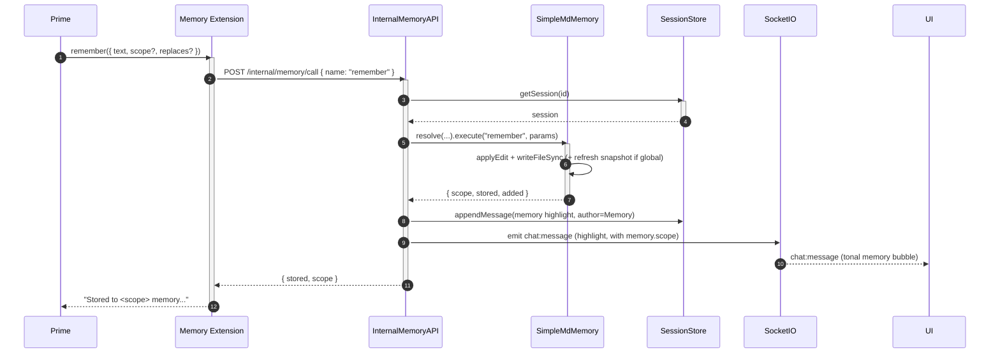

# Memory

[< Back to index](./index.md)

Memory is **pluggable**. Each session resolves to a tree of
[`MemoryBackend`](../../server/src/memory/types.ts) leaves — always the built-in
`SimpleMdMemory`, optionally joined (via [`CompositeMemory`](../../server/src/memory/composite.ts))
with the session's own [`MemoryBinding`](../../packages/shared/src/contracts.ts). The
[`MemoryResolver`](../../server/src/memory/resolver.ts) builds that tree, the Pi
spawn folds it into the child process, and the
[internal memory API](../../server/src/routes/internalMemory.ts) dispatches the
dispatcher-backed tools.

The default leaf, `SimpleMdMemory`
([simpleMd.ts](../../server/src/memory/simpleMd.ts); also re-exported as
`MemoryManager` from [pi/memory.ts](../../server/src/pi/memory.ts) for the
imperative callers), gives every session two markdown stores:

- **Global memory** — long-lived facts that apply across every session. Lives at
  `GLOBAL_MEMORY_DIR/GLOBAL_MEMORY.md`. Only mutated on an explicit user request
  (or after the user confirms a suggestion).
- **Session memory** — facts scoped to one session. Lives at the session root as
  `MEMORY.md`. Created lazily on Prime's first `remember`.

A defining principle: **the server is the sole writer.** A dispatcher-backed
memory tool only _requests_ a write; the server performs the file edit and
surfaces the "remembered" highlight from the actual change, so the UI shows
ground truth rather than the agent's narration (keeping the agent honest).
(Backends that own their tools inside the Pi process — like `pi-memory` — fall
outside this dispatcher path; see below.)

---

## The two files + the snapshot

- `globalFile()` = `GLOBAL_MEMORY_DIR/GLOBAL_MEMORY.md`.
- `sessionFile(root)` = `<root>/MEMORY.md`.
- `sessionGlobalSnapshot(root)` = `<root>/GLOBAL_MEMORY.md` — a read-only copy of
  global memory placed in the session root so the agent can read it with its own
  file tools.

`SimpleMdMemory.init(ctx)` (run as `resolvedMemory.init()` before the first spawn
in `pi.ensure`) ensures the global file exists and copies the snapshot into the
session root. The session memory file is intentionally **not** created here —
Prime creates it on its first `remember`.

`applyEdit(current, text, replaces?)` appends `text` as a new block, or — when
`replaces` matches a substring — swaps it in place, keeping a single trailing
newline.

---

## The injected preamble

Every agent's appended system prompt is joined with the resolved memory's
preamble (`session.resolvedMemory.preamble()` in
[piAgentManager.ts](../../server/src/pi/piAgentManager.ts)). For `SimpleMdMemory`
that is a `## Memory` block embedding the current global and session memory text
inline, so memory is authoritative standing context from the very first turn, and
it reminds the agent to modify it only via the memory tools. A composite joins
each leaf's preamble, so the session binding's project-memory note or `pi-memory`
guidance appears alongside it. Because the preamble is built at spawn time, each
new process (including each sub-agent) starts aware of the latest memory.

---

## Tools by role

The [memory extension](../../server/src/pi/extensions/memory.ts) registers a
fixed set of dispatcher tools inside each Pi process; each `execute` POSTs to
`/internal/memory/call`. A leaf declares which of them a role actually gets via
`tools(role)`, and the **spawn allowlist is the real gate** — a tool absent from
`--tools` is never offered, regardless of the extension registration. For
`SimpleMdMemory`:

- **All agents:** `read_memory` — returns the current session + global text.
  Sub-agents that spot something worth remembering must mention it in their reply
  and let Prime decide (per
  [subagentSystemPrompt.md](../../server/src/pi/subagentSystemPrompt.md)).
- **Prime only:** `remember` (write directly) and `suggest_memory` (propose a
  change the user must confirm). Prime owns the human conversation, so it is the
  sole writer.

`remember` uses `scope: "session"` by default (or when Prime spots a durable
session improvement) and `scope: "global"` ONLY on an explicit user request.
Anything Prime thinks is worth keeping but the user didn't ask to store —
especially global facts — goes through `suggest_memory` instead.

---

## Pluggable backends

A [`MemoryBackend`](../../server/src/memory/types.ts) declares its `preamble`,
its dispatcher `tools(role)`, its spawn extras (`spawn(ctx, role)` →
env / `--extension` paths / allowlist), and how to `execute` a dispatcher tool.
`CompositeMemory` unions several: it concatenates preambles, unions tools
(deduped), merges spawn extras, and routes `execute` to the first child that
owns the tool.

The `MemoryResolver` produces a session's `ResolvedMemory`:

- `resolveDefault(sessionId, root)` — **synchronous**, `SimpleMdMemory` only.
  Used by the spawn paths that can't `await` (`ensure` falls back to it).
- `resolve(sessionId, root)` — **async**; reads the session's own `MemoryBinding`
  from the session store (`getSessionMemory`) and, when present, returns a
  `CompositeMemory([SimpleMd, sessionLeaf])`. Entry points that can await
  (`createSession`, chat/roster join, triggers) call `pi.resolveMemory(...)`
  first and pass the result into `ensure`, which caches it on the session's
  process record so every spawn (first, revive, model-change) reuses it.

### The session's memory binding

Memory is an attribute of the **session**, not the mount. The binding is stored
on `sessions.memory` (server-only, like `sessions.env`); it is set at create time
from the create request's `memory` override, falling back to the agent bundle's
`memoryBinding` default (`body.memory ?? config.memory`). A shared folder is just
a mount point — point a binding's `root` at a mounted folder's path
(`<mountName>/…`) to land the store inside it and share it across sessions; omit
`root` to keep the store local to the session.

Each directory-backed leaf resolves its `root` relative to the session root, with
a guard that rejects any path escaping it. Bindings:

- `simple-md` → [`SharedMarkdownMemory`](../../server/src/memory/sharedMarkdown.ts)
  when a `root` is given: injects `<root>/MEMORY.md` as standing context; agents
  edit it with ordinary file tools (no dispatcher tools, no server write path).
  Without a `root` the always-on `SimpleMdMemory` already covers it, so the leaf
  adds nothing.
- `pi-memory` → [`PiMemory`](../../server/src/memory/piMemory.ts): binds the
  [`pi-memory`](https://www.npmjs.com/package/pi-memory) npm extension to
  `<root>/` (default `.pi-memory/`) as `PI_MEMORY_DIR`. It owns its tools
  (`memory_write`, `memory_read`, `scratchpad`, `memory_search`, …) inside the Pi
  process, so it contributes no server dispatcher tools — instead it adds its
  extension to `--extension` and allowlists its tools by role (Prime gets all;
  sub-agents get read-only `memory_read` / `memory_search` / `memory_status`).
  Its lifecycle hooks (snapshot injection on `before_agent_start`, exit summary on
  `session_shutdown`, qmd upkeep) run inside that process; all fire under
  `pi --mode rpc --no-session`. `PiMemoryConfig` tunes the hooks via env knobs
  (`exitSummary`, `snapshot`, `qmdUpdate`, `search`, `exitSummaryModel`) and
  defaults to "max memory power" (everything on).
- `composite` → nests the above.

---

## Sequence: direct write (`remember`)



The highlight card the user sees is built from `result.added` (the exact stored
fragment), not from anything the agent claimed.

---

## Sequence: suggestion -> confirm -> write

`suggest_memory` writes nothing; it records a `PendingSuggestion` and emits a
card. Only the user's confirmation applies it.

```mermaid
sequenceDiagram
  autonumber
  participant Prime
  participant Ext as Memory Extension
  participant Internal as InternalMemoryAPI
  participant Memory as SimpleMdMemory
  participant Socket as SocketIO
  participant UI
  participant Handlers as ChatHandlers
  participant PiManager

  Prime->>Ext: suggest_memory({ text, scope? })
  activate Ext
  Ext->>Internal: POST /internal/memory/call { name: "suggest_memory" }
  activate Internal
  Internal->>Memory: resolve(...).execute("suggest_memory", params)
  activate Memory
  Memory-->>Internal: { id }
  deactivate Memory
  Internal->>Socket: emit memory:suggestion { suggestionId, scope, text }
  Socket-->>UI: memory:suggestion (confirm/dismiss card)
  Internal-->>Ext: { ok, suggestionId }
  deactivate Internal
  Ext-->>Prime: "Awaiting confirmation; do not assume remembered."
  deactivate Ext

  UI->>Handlers: memory:confirm { suggestionId }
  activate Handlers
  Handlers->>Memory: takeSuggestion(id)
  activate Memory
  Memory-->>Handlers: pending suggestion
  deactivate Memory
  Handlers->>Memory: write(root, scope, text)
  activate Memory
  Memory-->>Handlers: { scope, added }
  deactivate Memory
  Handlers->>Socket: chat:message (memory highlight)
  Socket-->>UI: chat:message
  Handlers->>PiManager: sendToAgent("prime", "user confirmed...")
  activate PiManager
  PiManager-->>Prime: stdin prompt
  deactivate PiManager
  deactivate Handlers
```

A `memory:dismiss` takes the suggestion and tells Prime the user declined; it
writes nothing. Both confirm and dismiss are handled in
[sockets/chat.ts](../../server/src/sockets/chat.ts) (`handleMemoryConfirm` /
`handleMemoryDismiss`); the pending suggestion is validated against its
`sessionId` before anything is applied.
