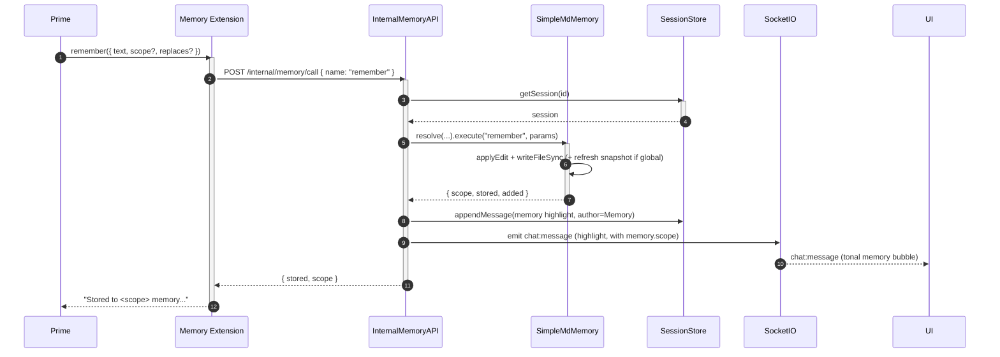

# Memory

[< Back to index](./index.md)

Memory is **pluggable**. Each session resolves to a tree of
[`MemoryBackend`](../../server/src/memory/types.ts) leaves — always the built-in
`SimpleMdMemory`, optionally joined (via [`CompositeMemory`](../../server/src/memory/composite.ts))
with the session's own [`MemoryBinding`](../../packages/shared/src/contracts.ts). The
[`MemoryResolver`](../../server/src/memory/resolver.ts) builds that tree, the Pi
spawn folds it into the child process, and the
[internal memory API](../../server/src/routes/internalMemory.ts) dispatches the
dispatcher-backed tools.

The default leaf, `SimpleMdMemory`
([simpleMd.ts](../../server/src/memory/simpleMd.ts); also re-exported as
`MemoryManager` from [pi/memory.ts](../../server/src/pi/memory.ts) for the
imperative callers), gives every session two markdown stores:

- **Global memory** — long-lived facts that apply across every session. Lives at
  `GLOBAL_MEMORY_DIR/GLOBAL_MEMORY.md`. Only mutated on an explicit user request
  (or after the user confirms a suggestion).
- **Session memory** — facts scoped to one session. Lives at the session root as
  `MEMORY.md`. Created lazily on Prime's first `remember`.

A defining principle: **the server is the sole writer.** A dispatcher-backed
memory tool only _requests_ a write; the server performs the file edit and
surfaces the "remembered" highlight from the actual change, so the UI shows
ground truth rather than the agent's narration (keeping the agent honest).
(Backends that own their tools inside the Pi process — like `pi-memory` — fall
outside this dispatcher path; see below.)

---

## The two files + the snapshot

- `globalFile()` = `GLOBAL_MEMORY_DIR/GLOBAL_MEMORY.md`.
- `sessionFile(root)` = `<root>/MEMORY.md`.
- `sessionGlobalSnapshot(root)` = `<root>/GLOBAL_MEMORY.md` — a read-only copy of
  global memory placed in the session root so the agent can read it with its own
  file tools.

`SimpleMdMemory.init(ctx)` (run as `resolvedMemory.init()` before the first spawn
in `pi.ensure`) ensures the global file exists and copies the snapshot into the
session root. The session memory file is intentionally **not** created here —
Prime creates it on its first `remember`.

`applyEdit(current, text, replaces?)` appends `text` as a new block, or — when
`replaces` matches a substring — swaps it in place, keeping a single trailing
newline.

---

## The injected preamble

Every agent's appended system prompt is joined with the resolved memory's
preamble (`session.resolvedMemory.preamble()` in
[piAgentManager.ts](../../server/src/pi/piAgentManager.ts)). For `SimpleMdMemory`
that is a `## Memory` block embedding the current global and session memory text
inline, so memory is authoritative standing context from the very first turn, and
it reminds the agent to modify it only via the memory tools. A composite joins
each leaf's preamble, so the session binding's project-memory note or `pi-memory`
guidance appears alongside it. The preamble is built per role: a sub-agent's
SimpleMD and `pi-memory` guidance only mentions the read tools it actually has
and tells it to report durable learnings to Prime. Because the preamble is built at spawn time, each
new process (including each sub-agent) starts aware of the latest memory.

---

## Tools by role

The [memory extension](../../server/src/pi/extensions/memory.ts) registers a
fixed set of dispatcher tools inside each Pi process; each `execute` POSTs to
`/internal/memory/call`. A leaf declares which of them a role actually gets via
`tools(role)`, and the **spawn allowlist is the real gate** — a tool absent from
`--tools` is never offered, regardless of the extension registration. For
`SimpleMdMemory`:

- **All agents:** `read_memory` — returns the current session + global text.
  Sub-agents that spot something worth remembering must mention it in their reply
  and let Prime decide (per
  [subagentSystemPrompt.md](../../server/src/pi/subagentSystemPrompt.md)).
- **Prime only:** `remember` (write directly) and `suggest_memory` (propose a
  change the user must confirm). Prime owns the human conversation, so it is the
  sole writer. This is enforced three ways: the extension registers them only
  for Prime, a sub-agent's spawn drops them (and pi-memory's write tools) even
  when its spawn request or template lists them, and `/internal/memory/call`
  rejects them unless the calling `agentId` is the session's Prime. That
  `agentId` is self-reported, so these checks keep sub-agents from writing
  through the memory tools but don't isolate an agent whose shell can read the
  internal token and call the endpoint directly. Malformed params (empty `text`, an unknown `scope`) are rejected with a 400.

`remember` uses `scope: "session"` by default (or when Prime spots a durable
session improvement) and `scope: "global"` ONLY on an explicit user request.
Anything Prime thinks is worth keeping but the user didn't ask to store —
especially global facts — goes through `suggest_memory` instead.

---

## Pluggable backends

A [`MemoryBackend`](../../server/src/memory/types.ts) declares its `preamble`,
its dispatcher `tools(role)`, its spawn extras (`spawn(ctx, role)` →
env / `--extension` paths / allowlist), and how to `execute` a dispatcher tool.
`CompositeMemory` unions several: it concatenates preambles, unions tools
(deduped), merges spawn extras, and routes `execute` to the first child that
owns the tool.

The `MemoryResolver` produces a session's `ResolvedMemory`:

- `resolveDefault(sessionId, root)` — **synchronous**, `SimpleMdMemory` only.
  The fallback when a full resolution fails.
- `resolve(sessionId, root)` — **async**; reads the session's own `MemoryBinding`
  from the session store (`getSessionMemory`) and, when present, returns a
  `CompositeMemory([SimpleMd, sessionLeaf])`. `pi.ensure` (async) calls it on
  every Prime spawn, whichever caller ensures first, and caches the result on
  the session's process record so every spawn under that Prime (sub-agents,
  revive, model-change) reuses it. `/internal/memory/call` runs against that
  cached resolution (and the live agent's role) whenever the calling agent is
  running, so a tool call never re-resolves memory; it only falls back to
  `resolve` plus the agent roster when the caller isn't live.

### The session's memory binding

Memory is an attribute of the **session**, not the mount. The binding is stored
on `sessions.memory` (server-only, like `sessions.env`); it is set at create time
from the create request's `memory` override, falling back to the agent bundle's
`memoryBinding` default (`body.memory ?? config.memory`). A shared folder is just
a mount point — point a binding's `root` at a mounted folder (`<mountName>`) or
a path inside it (`<mountName>/…`) to land the store there and share it across
sessions; omit `root` to keep the store local to the session.

Each directory-backed leaf resolves its `root` relative to the session root, with
a guard that rejects any path escaping it and the session root itself (`"."`),
whose `MEMORY.md` is SimpleMD's session memory. The guard then resolves
symlinks: the real path must still lie inside the session root, or be or lie
inside one of the shared folders **this session mounted** (its `mount` rows in
the resource catalog), so neither a re-pointed mount symlink nor a link planted in a mounted
folder can redirect a store into another session or an unmounted folder. The
resolved real path is kept and never re-resolved, so relinking the workspace
path after resolution can't move the store or its qmd index either. A shared
note (`<root>/MEMORY.md`) that is itself a symlink pointing outside its folder
is not injected.

A pi-memory `root` is either omitted (the session-local `.pi-memory/`) or names
a mount passed in the same create request, or a path inside one. Seed mounts are symlinked before
the binding is stored, and the binding is **settled once, at creation**
(`settleBinding`): a pi-memory leaf whose top-level folder isn't an existing
directory (an unseeded mount, or a mount whose shared folder is missing on disk)
is dropped, as is one that the pi-memory package can't load. The stored binding
then has no pi-memory leaf, so the session is SimpleMD-only for its whole life —
mounting the folder later does not turn pi-memory on. A missing top-level folder
is never created, so it can't occupy a mount name. If a store that existed at
creation later disappears, that Prime spawn leaves pi-memory out with a warning.
Bindings:

- `simple-md` → [`SharedMarkdownMemory`](../../server/src/memory/sharedMarkdown.ts)
  when a `root` is given: injects `<root>/MEMORY.md` as standing context; agents
  edit it with ordinary file tools (no dispatcher tools, no server write path).
  Until the note exists, the preamble says so and tells the agent where to
  create it.
  Without a `root` the always-on `SimpleMdMemory` already covers it, so the leaf
  adds nothing.
- `pi-memory` → [`PiMemory`](../../server/src/memory/piMemory.ts): binds the
  [`pi-memory`](https://www.npmjs.com/package/pi-memory) npm extension to
  `<root>/` (default `.pi-memory/`) as `PI_MEMORY_DIR`. It owns its tools
  (`memory_write`, `memory_read`, `scratchpad`, `memory_search`, …) inside the Pi
  process, so it contributes no server dispatcher tools — instead it adds its
  extension to `--extension` and allowlists its tools by role (Prime gets all;
  sub-agents get read-only `memory_read` / `memory_search` / `memory_status`).
  Its lifecycle hooks (snapshot injection on `before_agent_start`, exit summary on
  `session_shutdown`, qmd upkeep) run inside that process; all fire under
  `pi --mode rpc --no-session`. `PiMemoryConfig` tunes the hooks via env knobs
  (`exitSummary`, `snapshot`, `qmdUpdate`, `search`, `exitSummaryModel`) and
  defaults to "max memory power" (everything on). Every knob is emitted
  explicitly, and inherited `PI_MEMORY_*` / qmd env from the server or the
  session is dropped, so only the binding configures the store. Sub-agents run
  with the exit summary and qmd upkeep off, so they never append to the shared
  daily log. The preamble names the store by its workspace path (e.g.
  `project/pi-memory/`) and, when that differs from the real path pi-memory's
  tools report, says both name the same files.

  **qmd isolation.** pi-memory hard-codes one qmd collection name
  (`pi-memory`), so each store gets its own qmd index, and two sessions share a
  collection exactly when they resolve to the same real store directory (same
  shared folder, same `root`). The index and its config live **outside the
  store**, in server-owned state under `QMD_STATE_ROOT` (default
  `.qmd-state/`), keyed by the store's real path relative to `SHARED_ROOT`
  (`shared/<folderId>/<sub>`) or `SESSIONS_ROOT` (`sessions/<id>/<sub>`). The
  spawn points `INDEX_PATH` and `QMD_CONFIG_DIR` there. Prime's `init` rewrites
  that `index.yml` every time: one `pi-memory` collection over the store, with
  no `update:` hook and no model override. Agents that can write a shared
  folder therefore can't plant a command that other sessions' `qmd update`
  would run, and they can't repoint the collection. Deleting a session removes
  its `sessions/<id>/` state; shared-folder state outlives sessions. The server
  refuses to start when `SESSIONS_ROOT`, `SHARED_ROOT` and `QMD_STATE_ROOT` are
  the same directory or nested inside each other.

  qmd lets a project-local `.qmd/index.yml` (or `index.yaml`) found by walking
  up from its working directory (the session root) override both env vars, and
  pi-memory registers its collection there on start. When such a file exists at
  or above the session root, every spawn (Prime or sub-agent) **leaves
  pi-memory out** with a `[memory] qmd would use the project-local config …`
  error, rather than leak the store into a foreign index. Remove the stray
  `.qmd/` (e.g. from a `qmd init` in the repo or the sessions directory) and the
  next spawn picks pi-memory up again. The check runs at spawn time only: an
  agent can still create one in its session root while its process runs, and
  pi-memory runs `qmd` from that directory. Hosts that ran an earlier build may still have a
  global `pi-memory` collection in `~/.config/qmd/index.yml` and
  `~/.cache/qmd/index.sqlite`, or `.qmd/` directories inside stores; none are
  read any more and all are safe to delete.

  These are path-level guarantees for agents that use the memory tools, not an
  OS sandbox. An agent with unrestricted shell access can still read other
  sessions' files directly, or swap a directory inside a folder it can write
  for a symlink that pi-memory then follows; closing that is a
  process-sandbox concern, not a qmd one.

- `composite` → nests the above. At most one `pi-memory` leaf per binding (one
  Pi process loads the extension once); a stored binding with more than one
  degrades the session to SimpleMD-only.

---

## Sequence: direct write (`remember`)



The highlight card the user sees is built from `result.added` (the exact stored
fragment), not from anything the agent claimed.

---

## Sequence: suggestion -> confirm -> write

`suggest_memory` writes nothing; it records a `PendingSuggestion` and emits a
card. Only the user's confirmation applies it.

```mermaid
sequenceDiagram
  autonumber
  participant Prime
  participant Ext as Memory Extension
  participant Internal as InternalMemoryAPI
  participant Memory as SimpleMdMemory
  participant Socket as SocketIO
  participant UI
  participant Handlers as ChatHandlers
  participant PiManager

  Prime->>Ext: suggest_memory({ text, scope? })
  activate Ext
  Ext->>Internal: POST /internal/memory/call { name: "suggest_memory" }
  activate Internal
  Internal->>Memory: resolve(...).execute("suggest_memory", params)
  activate Memory
  Memory-->>Internal: { id }
  deactivate Memory
  Internal->>Socket: emit memory:suggestion { suggestionId, scope, text }
  Socket-->>UI: memory:suggestion (confirm/dismiss card)
  Internal-->>Ext: { ok, suggestionId }
  deactivate Internal
  Ext-->>Prime: "Awaiting confirmation; do not assume remembered."
  deactivate Ext

  UI->>Handlers: memory:confirm { suggestionId }
  activate Handlers
  Handlers->>Memory: takeSuggestion(id)
  activate Memory
  Memory-->>Handlers: pending suggestion
  deactivate Memory
  Handlers->>Memory: write(root, scope, text)
  activate Memory
  Memory-->>Handlers: { scope, added }
  deactivate Memory
  Handlers->>Socket: chat:message (memory highlight)
  Socket-->>UI: chat:message
  Handlers->>PiManager: sendToAgent("prime", "user confirmed...")
  activate PiManager
  PiManager-->>Prime: stdin prompt
  deactivate PiManager
  deactivate Handlers
```

A `memory:dismiss` takes the suggestion and tells Prime the user declined; it
writes nothing. Both confirm and dismiss are handled in
[sockets/chat.ts](../../server/src/sockets/chat.ts) (`handleMemoryConfirm` /
`handleMemoryDismiss`); the pending suggestion is validated against its
`sessionId` before anything is applied.
