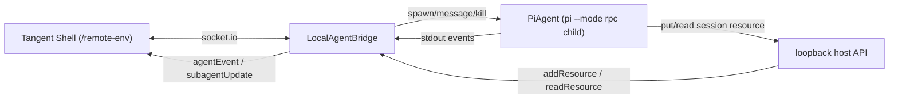

# @tangent/local-agent-host

The engine that hosts Tangent **sub-agents as local `pi` processes**, used by the
`tangent-local-agent` CLI (`apps/local-agent-cli`).

It connects to a Tangent Shell over the `/remote-env` Socket.IO namespace using
[`@tangent/remote-subagent`](../remote-subagent/README.md), maps each
`spawn` / `message` / `kill` command onto a local `pi --mode rpc` child process
working in the user's open folder, and streams that child's output back as the
same agent events a server-hosted sub-agent produces. It also offers Prime a set
of read-only workspace tools and lets a hosted sub-agent contribute files back
into the Tangent session.

This package is the **host runtime**; the thin CLI that parses flags, resolves a
workspace, and keeps a token fresh lives in `apps/local-agent-cli`.

## Architecture



- **`LocalAgentBridge`** ([src/bridge.ts](src/bridge.ts)) — the core. Holds the
  remote-env connection, a roster of hosted `pi` children, and the loopback host
  API. `connect(token, environmentId)` (re)connects with a fresh scoped token
  without interrupting running sub-agents; `dispose()` tears everything down.
- **`startScopedConnection`** ([src/scopedConnection.ts](src/scopedConnection.ts))
  — keeps the bridge connected with a self-renewing token: mints, connects, and
  schedules a refresh before expiry, pinning the environment id across refreshes.
- **`mintRemoteEnvToken`** ([src/remoteEnvToken.ts](src/remoteEnvToken.ts)) —
  mints a selector/session/user-scoped remote-env token from the Shell.
- **`PiAgent`** ([src/piAdapter.ts](src/piAdapter.ts)) — one long-lived
  `pi --mode rpc` child driven over stdin/stdout JSONL. `buildPiArgs` and
  `piEnv` assemble its launch; `src/piEvents.ts` translates pi's stdout into
  remote-env agent events.
- **Remote file tools** ([src/remoteFileTools.ts](src/remoteFileTools.ts)) —
  `createFileTools(getRoot)` returns the read-only workspace tools
  (`read_file` / `list_dir` / `find_files` / `search_text`) Prime calls over
  `/remote-env` without spawning a sub-agent. All paths resolve under the open
  folder, with the guards in [src/workspaceFs.ts](src/workspaceFs.ts).

## Usage

```ts
import { LocalAgentBridge } from "@tangent/local-agent-host/bridge.ts";
import { createFileTools } from "@tangent/local-agent-host/remoteFileTools.ts";
import { startScopedConnection } from "@tangent/local-agent-host/scopedConnection.ts";

const bridge = new LocalAgentBridge({
  url: "http://localhost:8787",
  selector: "projectId:abc",
  metadata: { editor: "my-editor", workspacePath: "/Users/me/proj" },
  tools: createFileTools(() => "/Users/me/proj"),
  piLaunchOptions: async () => ({
    bin: "pi",
    cwd: "/Users/me/proj",
    proxyExtensionPath: "/path/to/proxyProvider.ts",
    sessionResourceExtensionPath: "/path/to/sessionResources.ts",
  }),
  log: console.log,
  onChange: () => {},
  onSpawned: (agent) => console.log(`started ${agent.name}`),
});

// Keep a selector-scoped host connected with a self-renewing token:
const stop = startScopedConnection({
  shellUrl: "http://localhost:8787",
  selector: "projectId:abc",
  email: "me@example.com",
  connect: (token, environmentId) => bridge.connect(token, environmentId),
  onError: console.error,
});
```

## Session resources

A hosted `pi` sub-agent works in the user's **local** workspace, which is not the
Tangent session. So the host gives each sub-agent a small set of tools to push
files/blobs into the session — where Prime and every other agent (including
agents hosted on a different environment) can see and fetch them.

The chain:

1. The sub-agent calls `put_session_resource` / `list_session_resources` /
   `read_session_resource`, registered by the bundled pi extension
   [resources/sessionResources.ts](resources/sessionResources.ts) (loaded via
   `--extension` when a host API is configured).
2. The extension calls back into the host's **loopback HTTP API**
   ([src/hostApi.ts](src/hostApi.ts)) — bound to `127.0.0.1` on an ephemeral
   port and guarded by a random per-process bearer token, so only this host's own
   sub-agents can reach it.
3. The bridge forwards each call to the live connection's
   `addResource` / `listResources` / `readResource`, which the Shell's gateway
   services against the session catalog.

`put_session_resource` takes either inline `content` (for small text/blobs, with
`encoding: 'base64'` for binary) or a `sourcePath` — a local file path the tool
reads off disk itself, resolved against the sub-agent's working folder — so large
files transfer without the agent inlining their bytes. Provide exactly one; a
`sourcePath` read is sent base64 and rejected locally when it exceeds 1 MiB.

`buildPiArgs` loads the extension and `piEnv` injects `TANGENT_HOST_API_URL`,
`TANGENT_HOST_API_TOKEN`, `TANGENT_SESSION_ID`, and `TANGENT_AGENT_ID` only when a
`hostApiUrl` is present on the launch options; the bridge starts the loopback
lazily on the first spawn and closes it on `dispose()`. A `file` resource lands
under the session's `uploads/` folder (binary rides base64), catalogued and
surfaced to Prime; fetches are capped at 1 MiB. See the protocol and server side
in [`@tangent/remote-subagent`](../remote-subagent/README.md#session-resources).

## Bundled extensions (`resources/`)

`pi` loads these from disk, so a host copies them next to its bundle (the CLI's
`esbuild.mjs` does this). They are authored against pi's extension runtime, not
this repo's `node_modules`, so they are excluded from type-check and lint:

- [resources/proxyProvider.ts](resources/proxyProvider.ts) — points pi's model
  providers at the Shell's pi proxy (loaded only when a `proxyUrl` is set).
- [resources/sessionResources.ts](resources/sessionResources.ts) — the session
  resource tools described above (loaded only when a host API is configured).

## Exports

Consumers import modules directly, e.g. `@tangent/local-agent-host/bridge.ts`.
Key entry points: `bridge.ts` (`LocalAgentBridge`), `scopedConnection.ts`,
`remoteEnvToken.ts`, `piAdapter.ts`, `remoteFileTools.ts`, `hostApi.ts`,
`shellUrl.ts`, and the `resources/*` extensions.
